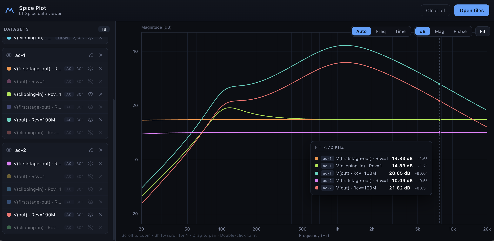
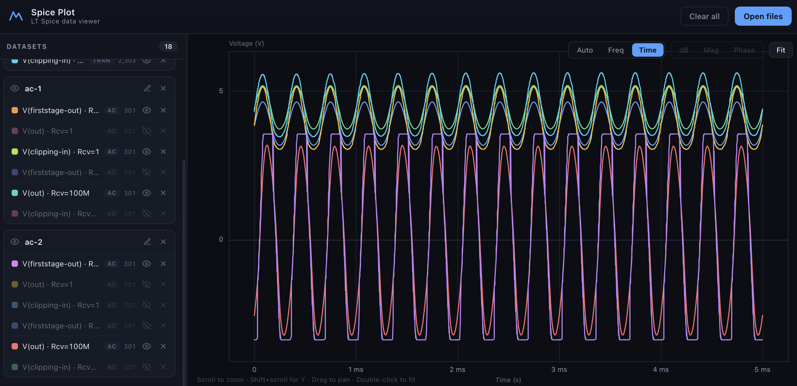
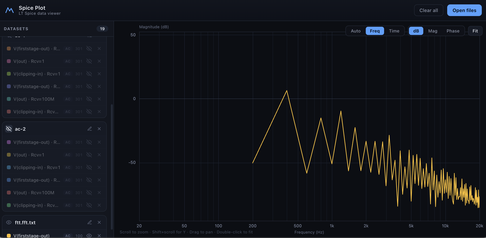

# Spice Plot
Simple one page web app for displaying LT Spice data
Drag your frequency or time domain LT Spice data exports onto the page. Stepped data is displayed as separate series. Data can be displayed or hidden per series or per file.

